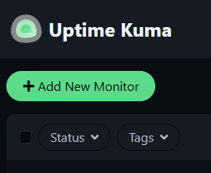
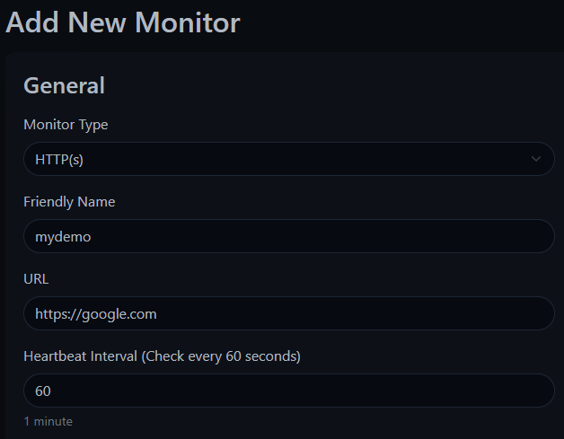
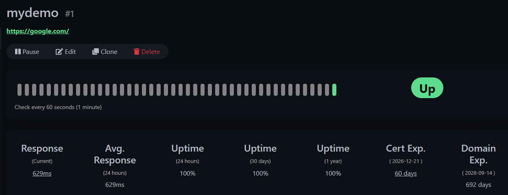
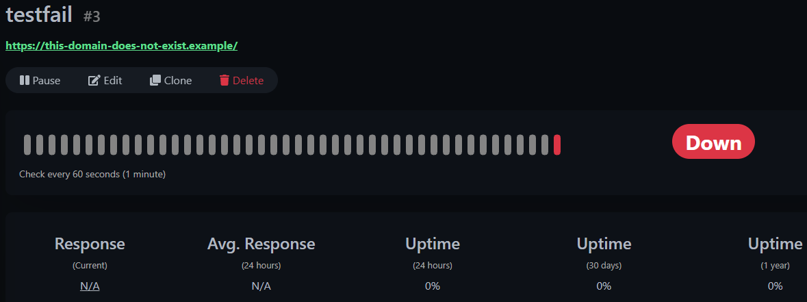

# Create your first monitor

This guide shows how to monitor a website or API using Uptime Kuma.

For this example, we will monitor a public website. You can use any URL that you have permission to monitor.

## Add an HTTP monitor

1. Open Uptime Kuma at `http://localhost:3001`.
2. Click **Add New Monitor** in the top-left corner.

   

3. Choose **HTTP(s)** as the monitor type.
4. Enter a name, for example: `mydemo`.
5. Enter the URL you want to monitor. `https://google.com`
6. Keep the heartbeat interval at `60` seconds for testing.
7. Select **Save**.

   

Uptime Kuma starts checking the URL immediately and displays the response of the URL.
  
  

## Understand the result

Any URL or API should display one of the following statuses:

| Status | Meaning |
|---|---|
| Up | The service responded successfully |
| Down | The service did not respond or returned an error |
| Pending | Uptime Kuma is still waiting for the first result |

Select the monitor to see its heartbeat history and response time.

## Test a failure

To see what happens when a service goes down, use a URL that does not exist, for example:

```text
[https://this-domain-does-not-exist.example](https://this-domain-does-not-exist.example)
```

Create a new monitor for that URL. After a few checks, the status should change to **Down**.



## Set up a notification

You can receive an alert when a monitor goes down.

1. Open **Settings**.
2. Go to **Notifications**.
3. Select **Set up Notification**.
4. Choose a notification provider.
5. Test the notification.
6. Assign it to your monitor.

Uptime Kuma supports many notification services.

## What to check next

- Response time trends
- Certificate expiry, if you are monitoring an HTTPS site
- Retry settings, so a short network problem does not create a false alert

## Next step

[Troubleshooting Monitors](troubleshoot-monitors.md)