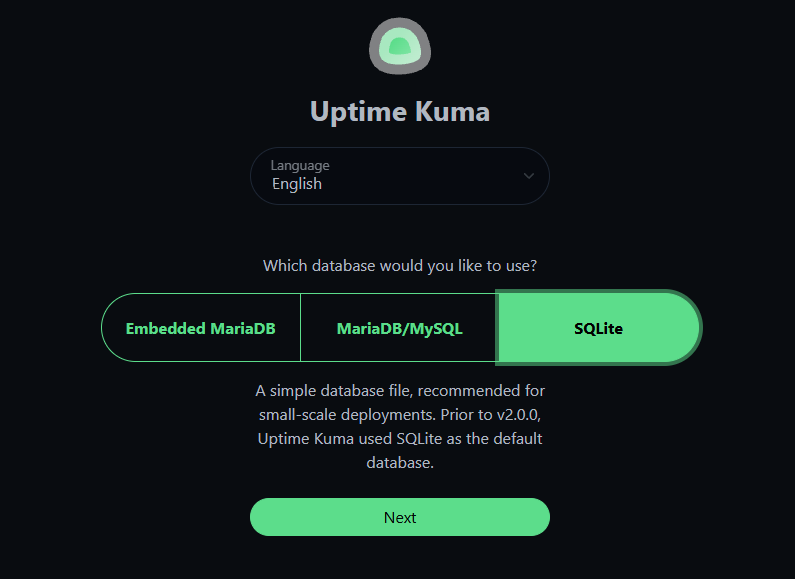
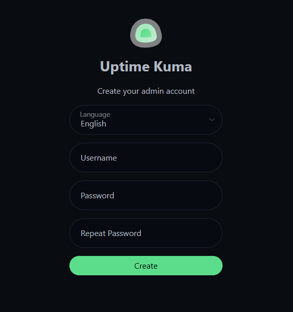

# Install Uptime Kuma with Docker

This guide explains how to run Uptime Kuma on  a local machine using Docker.

## Before you start

Ensure that Docker is installed and running on local PC.

To check, open a terminal and run:

```bash
docker --version
```

If Docker is installed, you should see a version number as below.


## Start Uptime Kuma

Run this command:

```bash
docker run -d \
  --restart=unless-stopped \
  -p 3001:3001 \
  -v uptime-kuma:/app/data \
  --name uptime-kuma \
  louislam/uptime-kuma:2
```

This command does four things:

- Starts Uptime Kuma in the background.
- Maps port `3001` on computer to port `3001` in the container.
- Creates a volume so settings and monitors are saved.
- Names the container `uptime-kuma`.

The container download completes in a few seconds.


## Open the dashboard

When the container starts, open in any browser:

```text
http://localhost:3001
```

On the first launch of Uptime Kuma, select a database and click **Next**.




Create an administrator account by choosing a memorable username and password, then click **Create**.



## Check that it is running

Run:

```bash
docker ps
```

You should see a container called `uptime-kuma`.

To view the logs, run:

```bash
docker logs uptime-kuma
```

## Stop and start again

To stop the container:

```bash
docker stop uptime-kuma
```

To start it again:

```bash
docker start uptime-kuma
```

Your monitors and settings remain saved because the data is stored in the Docker volume.

## Next step

[Create your first monitor](create-first-monitor.md)